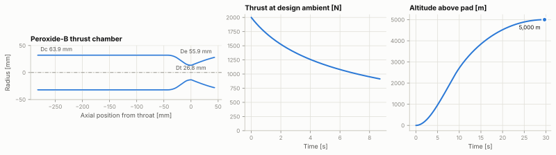

# LimeRocket

LimeRocket designs a small pressure-fed liquid rocket from one YAML file. You give it the thrust,
burn time, propellants, chamber pressure, feed system and airframe limits. It works out the
combustion with NASA CEA, sizes the thrust chamber and a Rao bell nozzle, the injector, feed
lines, tanks and pressurant, simulates the burn as tank pressure falls, and flies the result to
apogee. The output is one HTML report, CAD files for the chamber, and thrust curves for
OpenRocket and RocketPy.



Peroxide-B, a 2 kN blowdown HTP-90/RP-1 rocket whose burn time was searched to reach 5 km.
Its [report](examples/out/peroxide-blowdown/report.html), [STL](examples/out/peroxide-blowdown/peroxide-b-chamber.stl)
and [.eng curve](examples/out/peroxide-blowdown/peroxide-b.eng) are in `examples/out/`.

## Quick start

```sh
uv tool install git+https://github.com/kubanemil/LimeRocket
git clone https://github.com/kubanemil/LimeRocket && cd LimeRocket
limerocket design examples/lime-1.yaml -o out/
```

```
Lime-1: Liquid oxygen / 75% ethanol, 25% water (by mass), regulated feed

  O/F 1.372   Pc 22.00 bar   Tc 3,096 K   Ae/At 4.250
  Isp 218.9 s (vac 249.2 s)   mdot 0.4658 kg/s   c* 1,518 m/s
  Throat 20.23 mm   chamber 51.55 mm   exit 41.71 mm   length 233.3 mm
  Tank pressure 27.55 bar   injector dp ox/fuel 4.479/4.400 bar
  Burn 6.000 s   impulse 6,000 N s   thrust 1,000.0 -> 1,000.0 N
  Mass dry 9.274 kg   lift-off 12.18 kg   length 1.952 m
  Apogee 3,169 m   max Mach 1.01   max q 62.80 kPa   max accel 7.49 g
```

Then open `out/report.html`. Every spec key, with its unit and default, is in
[docs/spec.md](docs/spec.md). `limerocket catalog` lists the built-in propellants and materials.

## What it computes

| Stage | What happens | Key relations |
|---|---|---|
| Chemistry | CEA shifting equilibrium in an infinite-area combustor, expanded to the design ambient. With `mixture_ratio: auto` a bounded search finds the O/F with the highest Isp. | Gibbs energy minimisation (Gordon & McBride, RP-1311); Isp = c* Cf / g0 |
| Thrust chamber | Throat from the thrust target, chamber volume from L*, contraction ratio from the Humble correlation unless given, 80 % Rao bell, wall from hoop stress, injector plate from plate bending. | At = F / (Cf Pc); Vc = L* At; Ac/At = 8.0 Dt^-0.6 + 1.25; quadratic Bezier bell with SP-8120 angles; Roark flat plate |
| Injector | Orifices sized for the design flow at a minimum drop of 20 % of Pc. One tank pressure serves both sides, so the side with less line loss gets the stiffer injector. | mdot = Cd A sqrt(2 rho dp) |
| Feed lines | Pressure drop for each branch, laminar to fully rough. | Darcy-Weisbach dp = (f L/D + K) rho v^2 / 2 with Colebrook-White f |
| Pressurisation | Regulated: a bottle sized by an adiabatic energy balance. Blowdown: tank ullage sized from the blowdown ratio. | Vb = gamma p dV / (pb0 - pbf); p V^n = const |
| Burn | An ODE over the burn. At each step the chamber pressure balances injected flow against nozzle flow, using a CEA map at the fixed area ratio. Gives Pc, thrust, Isp, O/F drift and tank pressures over time, regulator dropout and which tank empties first. | mdot eta c*(O/F, Pc) = Pc At; `solve_ivp` with depletion and dropout events |
| Structures | Propellant tanks, pressurant bottle, mass budget. Spheres when they fit, otherwise cylinders with hemispherical heads. | sigma_hoop = p r / t; sigma_long = p r / 2t; sphere p r / 2t |
| Flight | Vertical, variable mass, to apogee. Thrust gets the back-pressure correction at altitude. Optional search of the burn time that hits an apogee target. | m dv/dt = F - D - m g; USSA 1976; Cd(Mach); g ~ 1/r^2 |

In blowdown mode the thrust target is the start of the burn, and the propellant load is scaled
so the burn lasts `burn_time_s`.

## Validation

`./do test` checks each stage against a published value (128 tests, about 15 s).

| Case | Reference | Max error |
|---|---|---|
| LOX/LH2, 53.3 bar, O/F 5.55: Tc, c*, Cf, Ivac at Ae/At 25 and 50, Isp at Pc/Pe 1000 | NASA RP-1311 example 8, CEA2 reference output | < 0.001 % |
| NTO/MMH, 1000 psia, O/F 2.5, frozen at the throat: c*, Ae/At, Isp, Ivac | NASA RP-1311 example 12, CEA2 reference output | < 0.001 % |
| LOX/LH2, 1000 psia, O/F 6, Ae/At 40: Tc, c*, Cf, Isp, Ivac | RocketCEA documentation | 0.007 % |
| A/A* and p/p0 at Mach 0.5, 2 and 3, gamma 1.4 | NACA Report 1135 tables | 0.014 % (table rounding) |
| Ideal engine: Ae/At, c*, ve, Isp, thrust, flow | proptools worked example (Sutton & Biblarz ch. 3) | 0.24 % (Ae/At printed as 11.9) |
| Bell angles at Ae/At 70 | Newlands (2017), after NASA SP-8120 | 0.5 deg |
| Colebrook, Re 1e4 to 1e8, e/D 0 to 0.05 | Haaland (1983) | 1.4 % (Haaland's own accuracy) |
| Colebrook at Re 1e5, e/D 0.001, and fully rough e/D 0.01 | Moody chart (1944) | 0.12 % |
| Smooth pipe, Re 1e4 to 1e5 | Blasius (1913) | 2.4 % |
| Orifice flow and line pressure drop | Hand calculation | 0.01 % |
| T, p and rho from 0 to 80 km | U.S. Standard Atmosphere 1976, table I | 0.007 % |
| Chamber volume from the drawn contour | L* x At | 0.1 % |
| Propellant expelled vs. mass gone from the tanks; pressurant mass | Mass conservation | 0.01 % |
| Blowdown ullage pressure | p V^n = const | 1e-10 |
| Bottle pressure at burnout with the closed-form bottle size | Adiabatic energy balance | < 1 % |
| Vertical vacuum flight at constant thrust | Rocket equation with gravity loss, analytic | 1e-6 |

## Pipeline

```
spec.yaml
   |  parse, check types, ranges and unknown keys            spec.py
   v
chemistry: O/F, c*, Cf, Ae/At, Isp                            thermo.py (NASA CEA)
   v
thrust chamber: At, L* volume, Rao contour, walls             chamber.py, nozzle.py
   v
injector and lines: orifices, tank pressure                   hydraulics.py
   v
tanks and pressurant: volumes, walls, bottle, mass budget     tanks.py, design.py
   v
burn ODE: Pc(t), F(t), O/F(t), tank pressures  <-- CEA map    feed.py
   v
flight ODE: apogee, max-Q, burnout, rail exit                 trajectory.py, atmosphere.py
   |
   +--> apogee target set? search the burn time, rerun from the tanks down
   v
report.html, contour CSV/DXF/STL, .eng, RocketPy CSV          report.py, export.py
```

## Layout

```
src/limerocket/
  cli.py          limerocket design | catalog
  spec.py         YAML to validated, SI dataclasses
  propellants.py  catalog: CEA species, density, viscosity
  thermo.py       CEA wrapper, O/F search, off-design map
  nozzle.py       ideal-rocket relations, Rao bell
  chamber.py      L* chamber, throat arcs, wall, injector plate
  hydraulics.py   Colebrook, Darcy-Weisbach, orifices
  feed.py         pressurisation and the burn ODE
  tanks.py        thin-wall pressure vessels
  materials.py    structural allowables
  atmosphere.py   USSA 1976
  units.py        constants and conversions
  trajectory.py   vertical flight
  design.py       the pipeline and apogee search
  plots.py        report figures
  report.py       HTML report and terminal summary
  export.py       CSV, DXF, STL, .eng, RocketPy
tests/            validation against published references
examples/         two specs and their generated outputs
docs/spec.md      every spec key
```

## Development

```sh
./do test        # pytest
./do check       # ruff check, ruff format --check, mypy --strict
./do fmt         # apply ruff fixes and formatting
./do run design examples/lime-1.yaml -o out
./do examples    # regenerate examples/out
```

## Decisions

| Choice | Not chosen | Why |
|---|---|---|
| NASA's `cea` wheel | RocketCEA, Cantera | RocketCEA publishes wheels only for Windows and needs gfortran elsewhere. Cantera has wheels but no rocket problem, so the throat search, expansion and liquid propellant enthalpies would be hand-built. `cea` is NASA's own code and thermo data, 3 MB, with wheels for Linux, macOS and Windows, and it reproduces NASA's reference outputs to five digits. |
| Python 3.12 to 3.14 | 3.15 | `cea` has no 3.15 wheel yet. The cap stops `uv tool install` from attempting a Fortran build. |
| Dataclasses and a small validating reader | pydantic | One dependency fewer, and every problem is still reported with its key path. |
| Units in names (`chamber_pressure_pa`, `thrust_n`), SI inside | pint | The unit is visible at every call and costs nothing at run time. The spec carries the unit in each key. |
| Pc solved from the flow balance at every step | Fixed Pc, flow scaled with tank pressure | Tanks, lines, injector and nozzle stay coupled, so O/F drift and regulator dropout come out of the physics. |
| CEA map over O/F and log Pc for the burn | A CEA call per ODE step | 276 CEA solves take about 0.6 s, then each step is cheap. The map stays within 0.2 % of direct CEA. |
| One tank pressure for both propellants | A regulator per tank | Matches most amateur plumbing. The injector on the lower-loss side takes the difference. |
| CSV, DXF (R12) and binary STL written directly | ezdxf, numpy-stl | Each format is a few dozen lines. ezdxf is a test dependency that checks the DXF. |
| matplotlib object API, SVG inline | Plotly, pyplot | The report is one file with no JavaScript, and no pyplot global state. |
| 80 % Rao bell only | Other bell lengths, method of characteristics | The SP-8120 angle chart is digitised here for 80 %, the usual choice. |

## Limitations

- No heat transfer. Walls are sized for pressure at room-temperature strength; a real chamber
  needs cooling or an ablative liner.
- Losses enter only through the c* and Cf efficiencies in the spec.
- The Rao angle chart covers Ae/At 4 to 100. Outside it the angles are clamped and the report
  says so.
- The pressurant is an ideal gas. Helium at 300 bar holds about 12 % less mass than an ideal gas
  would, which the default 20 % bottle margin covers.
- Tanks and bottle are adiabatic. No heat from the walls or the liquid, no gas dissolving, no
  start or stop transients, no acceleration head on the liquid.
- Liquid-liquid injection only. Self-pressurising N2O and catalyst-bed peroxide, which injects
  hot gas, are not modelled.
- Flight is vertical with one degree of freedom, a generic Cd(Mach) table, no wind and no
  recovery. Replace the table with OpenRocket or RASAero data for a real airframe.
- Structures cover pressure only: no flight loads, buckling, welds or fittings.

## Roadmap (milestone 2)

- Bartz heat flux along the contour and regenerative cooling channel sizing.
- 6-DOF flight with wind, fin sizing and stability margin.
- RocketPy coupling: build a `LiquidMotor` from the design instead of exporting a curve.
- A web UI that edits the spec and redraws the report.
- Self-pressurising N2O tanks, other bell lengths and a method-of-characteristics nozzle.

## License

MIT
